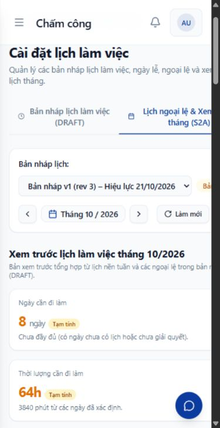
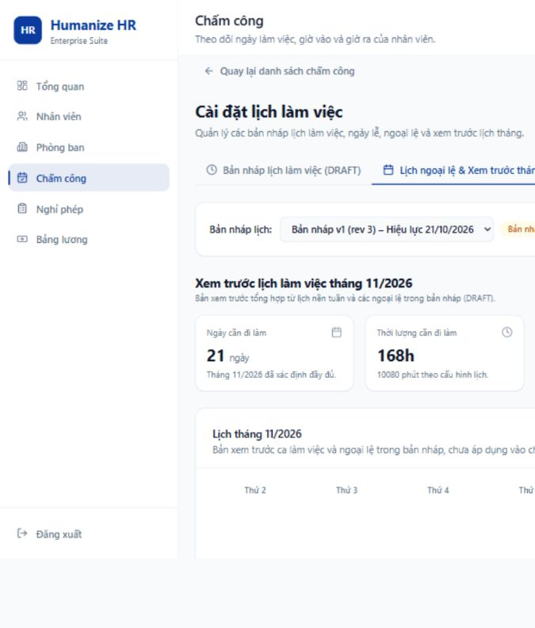

# S2A — Frontend–Backend Integration Review

**Bổ sung sau review22/10:** người dùng mở rộng nghiệp vụ preset/kỳ nghỉ. [Backend v1.1](attendance-payroll-s2a-holiday-batch.md) đã READY với137 tests và full build PASS (người dùng đã dừng server nhả DLL). Kết quả build BLOCKED bên dưới là lịch sử vòng review trước. F11 responsive vẫn OPEN; UI preset/batch chưa có và cần review tích hợp sau Anti. Không lấy Backend READY làm slice DONE.

Ngày 22/10/2026. Contract: [Exact API v1](../modules/work-calendar-s2a.md). Review source mới nhất của Anti và Backend thật; CodeGraph + skill code-review, minimal accessibility review theo dispatcher frontend. Không activate, migration, S2B, commit/push hoặc xác nhận QA thay người dùng.

## Kết luận

**CHƯA PASS toàn slice.** Các lỗi logic/API/state được Codex sửa và kiểm thử lại PASS. Còn **F11 — responsive mobile, owner Anti**. Frontend đã implement nhưng chưa đạt gate READY; integration review chưa đóng, người dùng QA/done chưa thực hiện.

Không phát hiện lỗi Backend mới cần sửa trong phạm vi kiểm thử. Backend source/migration đang có trong working tree là phần S2A trước đó, không phải thay đổi mới của lượt review này.

## Findings

| ID | Mức / owner | Trước review | Sau review |
| --- | --- | --- | --- |
| F01 | P1 / Frontend logic | Mở sửa từ DTO list và revision đang thay đổi; dữ liệu form có thể không khớp revision gửi | PASS: GET parent + detail, kiểm tra cùng revision/id/version, giữ snapshot revision riêng cho form |
| F02 | P1 / Frontend logic | Reload 409 có thể nuốt GET lỗi, không kiểm tra revision parent/detail; tạo mới giữ input cũ nhưng nhận revision mới | PASS: lỗi tải/mismatch được báo, không ghi đè input; reload cần xác nhận bỏ thay đổi rồi reset từ snapshot thật |
| F03 | P1 / Frontend logic | Placeholder giữ list/preview của version hoặc tháng trước dưới lựa chọn mới | PASS: list chỉ giữ trang trước trong cùng version; preview không dùng dữ liệu của key khác |
| F04 | P2 / Frontend logic | Mọi HTTP 409 đều được coi là revision conflict | PASS: chỉ WORK_SCHEDULE_REVISION_CONFLICT mở luồng reload; conflict nghiệp vụ khác hiển thị mapping tiếng Việt đúng code |
| F05 | P2 / Frontend logic | Mutation invalidate rồi page refetch lần nữa; thiếu invalidation detail khác và khi S1 sửa lịch nền | PASS: dùng chung query keys/cache helper; một lần invalidate mỗi query; S1 PATCH làm stale S2A; query list S1 tắt khi tab ẩn |
| F06 | P2 / Frontend logic | Xóa dùng revision động, không có recovery đầy đủ sau stale409 | PASS: revision đóng băng; stale chặn submit; reload có xác nhận, cập nhật summary/revision và xóa lý do cũ |
| F07 | P2 / Frontend logic | Đóng/đổi loại/reload có thể mất form chưa lưu; thiếu khóa synchronous double-submit | PASS: ConfirmDialog dùng lại, giữ dirty input nếu hủy; ref khóa submit; date edit không xóa cảnh báo stale |
| F08 | P2 / Frontend validation | Date.UTC sai năm 0001–0099; year query không đủ 4 chữ số; tháng mặc định theo máy | PASS: civil-date validation đúng contract; year padStart(4); tháng theo Asia/Ho_Chi_Minh; prev/next cập nhật functional, chặn biên 1–9999 |
| F09 | P2 / Frontend data flow | Draft selector chỉ lấy 50 bản đầu; lỗi parent list bị hiện như danh sách rỗng | PASS: options query đi qua pagination API hiện có, dedup id; error/retry riêng |
| F10 | P1 / Frontend semantics | Preview gọi số ngày cấu hình là ngày công chuẩn và phút làm việc thực tế; coverage thiếu vẫn nói100% | PASS: dùng ngày/thời lượng cần đi làm theo lịch; null/partial hiện tạm tính; không suy thành công/lương hoặc đủ điều kiện activate |
| F11 | P2 / UI responsive — Anti | Nội dung rộng hơn vùng mobile và bị layout ngoài cắt | **OPEN**: tái hiện trên API thật 375px và390px; hướng sửa bên dưới |
| F12 | P1 / Frontend interaction | Confirmation bỏ thay đổi dùng Radix AlertDialog và Dialog từ dependency tree khác phiên bản, hai focus trap cạnh tranh; nút Hủy không hoạt động thực tế | PASS browser tải sạch: chỉ dialog trên cùng sở hữu modal focus; confirmation đặt trong vòng đời content cha. Hủy giữ input, discard đóng và trả focus, trang không bị khóa pointer sau đóng |

Tab có roving tabindex, ArrowLeft/ArrowRight/Home/End, aria-controls/labelledby; filter có aria-pressed. Không đánh accessibility toàn hệ thống PASS chỉ từ các kiểm tra này.

### F11 — Bàn giao Anti (chỉ CSS/layout/responsive)

- `frontend/src/pages/admin/attendance/WorkScheduleSettingsPage.tsx:229`: tab strip hai label dài tạo intrinsic width khoảng424px.
- `frontend/src/pages/admin/attendance/components/CalendarTabContent.tsx:184`: root grid/toolbar/draft selector chưa co đúng theo vùng content mobile; section cũng rộng khoảng424px.
- `frontend/src/pages/admin/attendance/components/MonthlyPreviewCard.tsx:295`: grid7 cột và nội dung ô ngày cần layout mobile phù hợp, không để chữ/ca tràn ô.
- Tại390px, tab right440.1px, grid right415.3px; tại375px vẫn right440.1/415.3. Document scrollWidth375/360 vì container ngoài che overflow, **không phải bằng chứng responsive đạt**. Tablet768px: tab right728.8/grid704; desktop1280px: tab1240.8/grid1216 đều nằm trong viewport.
- Hướng sửa: min-w-0 ở grid/flex boundaries, tab/selector/nav co hoặc wrap có chủ đích, day-cell compact phù hợp mobile. Không dùng overflow-hidden toàn trang để che lỗi; không thay query/DTO/date/revision logic. Kiểm tra375/390/768/1280 và dialog thấp.
- Form tạo tại390×560: dialog nằm trong viewport, footer Hủy bottom≈526px, body height335px/scrollHeight798px. Đây là phần đã kiểm tra được, không đồng nghĩa toàn page mobile đạt.



## Đối chiếu 6 API và dữ liệu

Base `/api`, Bearer qua Axios hiện có, ADMIN router/middleware không đổi.

| API | API layer trả cho UI |
| --- | --- |
| GET versions/:versionId/exceptions | response.data giữ nguyên `{data:[],meta,scheduleRevision}` |
| GET versions/:versionId/exceptions/:id | response.data.data → `{exception,scheduleRevision}` |
| POST versions/:versionId/exceptions | response.data.data; body `{expectedRevision,exception}` |
| PATCH versions/:versionId/exceptions/:id | response.data.data; full replace exception, không partial fields |
| DELETE versions/:versionId/exceptions/:id | response.data.data; JSON body config.data `{expectedRevision,reason}` |
| GET work-calendar/preview | response.data.data → CalendarPreviewDto; versionId/year/month, year4 chữ số |

Các path versions trên đều dưới `/work-calendar/`. Axios adapter tests kiểm tra cả6 envelopes/body/params, không đổi backend contract.

- HOLIDAY giữ tên/căn cứ/lý do. COMPENSATORY_OFF gửi ngày nguồn và ngày thực nghỉ; quy tắc phân bổ được Backend kiểm tra, FE không tự viết engine thứ hai.
- SWAP gửi một exception chứa cả offDate/workDate, tạo/sửa/xóa atomic qua một mutation. List date-range Backend xét cả hai ngày, có pagination/kind/fromDate/toDate. UI hiện có filter loại và pagination; không thêm date filter UI ngoài scope.
- WORK_OVERRIDE gửi giờ HH:mm và đúng một break; FE dùng RHF/Zod, Backend vẫn là nguồn validation cuối cùng.
- Preview dùng days/summary/validation từ Backend; không đổi null thành0 để làm lịch có vẻ đầy đủ. isComplete chỉ coverage tháng; hasBlockingIssues thuộc toàn DRAFT. Issue ngoài tháng vẫn có nhãn phạm vi, không bỏ khỏi cảnh báo.
- S1 đổi lịch nền không xóa ngoại lệ mất hợp lệ. Resolver giữ event, trả BLOCKER/null; repair/delete dùng cùng CAS revision. PostgreSQL tests có liên tiếp nghỉ bù qua năm, target không trùng, source dependencies, cross-month SWAP, whole-DRAFT blockers và repeatable snapshots.

## Files sửa trong lượt review

Frontend logic/data:

- `features/work-schedule/api/calendar-exception.api.ts`: serialization year.
- `features/work-schedule/hooks/useCalendarExceptionQuery.ts`, `useWorkScheduleQuery.ts`: scoped placeholder, options pagination, enable/invalidation.
- `features/work-schedule/lib/calendar-exception.schema.ts`, `calendar-exception.helpers.ts`: validation/date và localized error codes.
- Tạo `lib/calendar-exception.editor.ts`, `work-calendar.query-keys.ts`, `work-calendar.cache.ts`: snapshot loading, query keys và invalidation dùng chung.
- `pages/admin/attendance/WorkScheduleSettingsPage.tsx`: query tab ẩn và keyboard tabs.
- `pages/admin/attendance/components/CalendarTabContent.tsx`: form snapshot, open/reload loading/error/retry, navigation và bỏ refetch trùng.
- `CalendarExceptionFormDialog.tsx`, `CalendarExceptionDeleteDialog.tsx`: stale/dirty/pending/discard/reload/focus ownership.
- `MonthlyPreviewCard.tsx`: sửa ý nghĩa text/coverage/issue labels, không redesign CSS.

Tests/docs:

- Tạo `frontend/tests/work-calendar-contract.test.tsx`; mở rộng `frontend/tests/work-calendar-s2a.test.tsx`.
- Report này, ảnh evidence và checklist S2A; cập nhật trạng thái đầu contract để không còn ghi chưa Frontend.
- Không sửa backend application, auth, Attendance/Payroll, environment hoặc deployment trong lượt review.

## Verification thực chạy

| Lệnh / kiểm tra | Kết quả |
| --- | --- |
| Frontend npm run test | **PASS:95 Vitest +5 Node helper =100**,11 Vitest files; gồm regression S1 |
| Frontend npm run lint | PASS |
| Frontend npm run build | PASS tsc/Vite; còn warning chunk lớn≈1.52MB, không mở refactor bundle ngoài scope |
| Backend npx tsc --noEmit | PASS |
| Backend node --test bộ7 files bên dưới với S1/S2A DB flags | **115 PASS,0 fail,0 skip**; PostgreSQL/HTTP thật trong schema riêng, cleanup |
| Backend npm run build | **BLOCKED/FAIL môi trường** tại prisma generate: EPERM rename query_engine-windows.dll.node. Không tự dừng server; không suy tsc PASS thành full build PASS |
| Browser local API thật | ADMIN đăng nhập, GET draft/list/preview, tháng10 partial/tháng11 complete, form open/discard/cancel/focus, desktop/tablet/mobile và dialog thấp đã kiểm tra |

Backend command (PowerShell trong backend):

```powershell
$env:HRM_S1_DB_TEST='1'
$env:HRM_S2A_DB_TEST='1'
node --test --test-reporter=spec tests/work-schedule.test.cjs tests/work-schedule.integration.test.cjs tests/calendar-exception.test.cjs tests/calendar-exception.integration.test.cjs tests/attendance-adjustment.test.cjs tests/attendance-monthly-report.test.cjs tests/admin-dashboard.test.cjs
```

Frontend tests từng gặp lỗi cache ENOENT trong sandbox; chạy lại ngoài sandbox thành công. Kết quả cuối ở bảng là lần chạy lại sau sửa confirmation; test dùng lại node DOM cũ sau remount đã được chỉnh đọc form hiện tại.

Browser chỉ mở/đóng form, không POST/PATCH/DELETE dữ liệu public để tạo fixture. CRUD4 loại được test bằng Axios adapters/RHF/mutations và PostgreSQL HTTP thật, **chưa phải browser end-to-end toàn CRUD**. ADMIN-only có route guard/source và HTTP tests; chưa chạy Employee browser flow riêng. Attendance regression bằng tests/source, không check-in/out thực tế trong review này. Không chạy migration/reset/seed trong lượt này.



## QA localhost cho người dùng

UI: http://localhost:5173/admin/attendance/settings?tab=calendar ; API: http://localhost:3000/api. Server local có sẵn, Codex không tự restart/dừng.

1. ADMIN: tab S1 tạo DRAFT demo T2–T6,08–17,nghỉ12–13,effectiveFrom2026-12-01; chuyển calendar và chọn đúng draft. S1 lưu/sửa vẫn hoạt động, không activate.
2. HOLIDAY26/12/2026 và27/12/2026 với căn cứ; thêm nghỉ bù theo target Backend28/12 và29/12, không trùng. Thử sai target/nguồn thấy lỗi tiếng Việt, giữ form.
3. SWAP off31/12/2026/work02/01/2027: đổi preview12/2026↔01/2027, cả hai nửa đúng; sửa/xóa có lý do, list/preview tự cập nhật không refresh trang. WORK_OVERRIDE một ngày làm với giờ/break hợp lệ; thử break sai và ngày không tồn tại.
4. Sau tạo SWAP, sửa S1 bỏ thứ Năm khỏi weekdays: ngoại lệ còn, preview có BLOCKER/null. Xem tháng không chứa ngoại lệ lỗi vẫn thấy global blocker, không suy tháng complete thành toàn draft hợp lệ.
5. Hai tab cùng revision: tabA lưu trước, tabB lưu nhận409; nội dung chưa lưu còn. Reload phải hỏi bỏ thay đổi; Hủy giữ input. Tắt API thử reload lỗi, bật lại retry. Sau reload cần kiểm tra dữ liệu mới trước submit. Bấm Next nhanh không vượt trang cuối; đổi draft không nhìn/sửa nhầm list cũ.
6. Responsive375/390 hiện **known FAIL F11**, chờ Anti sửa rồi Codex review lại. Kiểm tra thêm768/1280, keyboard tabs/focus, dialog thấp/body scroll và trở về Attendance không regression.

Muốn xác minh lại full Backend build: người dùng dừng backend local giữ Prisma DLL, chạy npm run build trong backend rồi mở lại server. Chưa có bằng chứng full build PASS trong lượt review này.

## Luồng dễ hiểu và gate tiếp theo

UI chỉ gửi cấu hình ngoại lệ; Backend tính preview. Khi mở form, FE chụp dữ liệu và revision nhất quán. Khi lưu, Backend so revision để tránh ghi đè người khác. Thành công thì invalidate đúng cache lịch liên quan; TanStack Query lấy lại list/preview đang mở, không tải lại cả trang và không đổi Attendance hiện hành. Nếu conflict, giữ input cho đến khi người dùng đồng ý bỏ và tải nguồn mới.

Cách trình bày phỏng vấn: “Em tách draft configuration khỏi attendance thực tế, dùng optimistic concurrency với revision, giữ form chưa lưu khi409 và kiểm tra cả API envelope lẫn PostgreSQL transaction; cache invalidation có scope thay vì refetch toàn ứng dụng.”

**Bước tiếp:** Anti xử lý F11 → Codex re-review responsive và kiểm tra lại integration → người dùng QA/done S2A. Không tự chuyển S2B.

## Cập nhật sau integration re-review v1.1 — 22/10/2026

Phần trên là evidence lịch sử v1. [Report mới nhất](attendance-payroll-s2a-v11-integration-review.md): Backend full build/137 tests PostgreSQL thật PASS; Frontend110 Vitest+5 Node/lint/build PASS sau sửa logic. F11 tab/toolbar/grid đã browser đo375/390/768/1440 PASS. Còn FUI-01/P2 mới: mobile bảng review batch chật/scroll ngang, giao Anti chỉ UI. S2A chưa DONE/user QA, không S2B.
