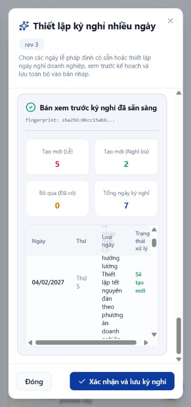
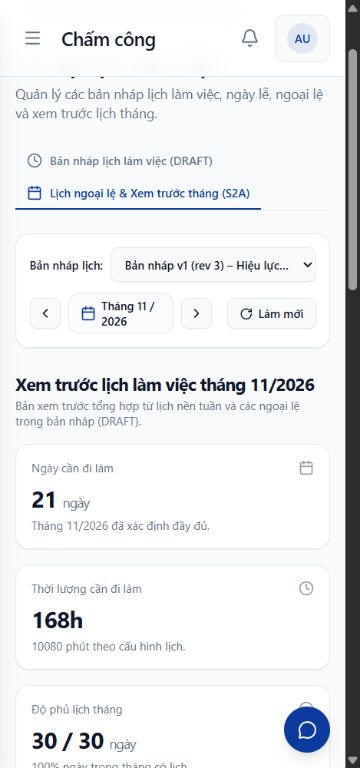

# S2A v1.1 — Integration Re-review

Ngày 22/10/2026. Scope: code Frontend mới nhất của Anti đối chiếu Exact Contract v1/v1.1; sửa logic, không S2B/migration/commit/push. Người dùng chưa QA/done.

## Kết luận

**Logic/API và automated regression PASS sau sửa; chưa PASS toàn slice** vì còn **FUI-01/P2** thuần UI giao Anti: bảng review batch quá chật, có scroll ngang trong dialog 375/390px. F11 cũ (tab/toolbar/calendar trang chính) đã PASS đo thực tế, không còn là finding mở.

## Findings và sửa chữa

| Finding | Trước sửa | Sau sửa / evidence |
| --- | --- | --- |
| R1/P1 snapshot batch | Mở batch từ revision list; callback reload dùng editorSnapshot chưa tồn tại hoặc ngoại lệ cũ | CalendarTabContent mở qua loadCalendarEditor, GET parent mới, lưu snapshot/revision độc lập; batch không có exceptionId. Regression test list rev3/parent rev9, hiệu lực 2027 PASS |
| R2/P1 company input | Bỏ qua dòng chưa đủ thông tin, có fallback tự tạo căn cứ/lý do | Helper reuse holidayFormSchema; mọi dòng đều validate, bắt buộc căn cứ/lý do/isPaid, không silent omit. Thêm trường lý do còn thiếu, reuse DatePicker |
| R3/P1 preview/commit | Dùng lại plan khi input/công bố catalog thay đổi; compile payload lại khi commit | Một review gồm request+plan+inputKey. Chỉ commit request đã review kèm fingerprint; đổi input/catalog làm plan mất hiệu lực; ref khóa double-submit và fieldset khóa pending |
| R4/P1 conflict | Sửa input có thể gỡ conflict lock; reload không reset đúng selections hoặc mất form khi lỗi | 409 revision giữ lock/input; xác nhận bỏ dữ liệu trước reload; chỉ reset khi fresh GET thành công. PLAN_CHANGED cần preview lại, không giả stale revision |
| R5/P1 focus confirmation | ConfirmDialog là sibling ngoài content, rủi ro focus ownership giữa các Radix version | Đặt confirmation trong vòng đời content, giữ modal guard. Browser thật: Hủy giữ lựa chọn/plan, discard đóng, focus trả trigger, pointer auto và page clickable |
| R6/P2 catalog/year/error | Hardcode range năm và default 2026; edit lễ lấy năm effectiveFrom thay vì ngày lễ; thiếu retry | Dùng năm ngày lễ/hiệu lực hoặc năm hiện tại Asia/Ho_Chi_Minh, nhập 1–9999; GET theo năm rõ ràng; unavailable tiếng Việt, retry và source links đầy đủ |
| R7/P2 classification | Lễ mới có thể không phân loại; nút toggle bỏ policy, khác với BE giữ policy khi PATCH omit; chọn preset không kiểm tra ngày | Lễ mới bắt buộc chọn loại; legacy vẫn đọc/sửa không mặc định PAID; category không tự bỏ chọn; kiểm tra ngày thuộc preset; đổi sang COMPANY phải nhập căn cứ/lý do nội bộ |
| R8/P2 tests/envelope | npm run test ban đầu lỗi TS: fixture BatchCommitResponse không có envelope và Axios mock bọc thừa | Sửa fixture theo envelope thật; bổ sung UI/state/parent integration regression. Không lấy con số Anti report thay kết quả thực chạy |
| R9/P2 review metadata | Mọi HOLIDAY trong range có thể bị ghi là sẽ tạo mới | Dùng toCreate để nhận diện, hiện policy/pay/weekly-rest/reason đúng plan. BLOCKER khác của DRAFT không chặn lưu draft; chưa có activation |

Không tìm thấy lỗi Backend cần sửa trong lượt review này. Không thay contract, Prisma hoặc Attendance/Payroll production logic. Không bổ sung nguồn lịch/lunar inference. Chỉ đối chiếu catalog tĩnh với nguồn và giới hạn đã ghi trong contract, không tái chứng nhận pháp lý các nguồn ngoài trong lượt này.

## Contract/data flow đã kiểm tra

- 6 API v1: list/detail/create/replace/delete ngoại lệ theo version, monthly preview. 3 API v1.1: GET holiday-presets?year, POST exceptions/batch-preview, POST exceptions/batch. Axios và hooks unwrap đúng theo từng envelope; query keys chứa version/filter/page hoặc năm/tháng.
- SWAP gửi một payload/cặp atomic; COMPENSATORY_OFF do Backend phân bổ, không FE tự tính target. Preset unavailable không sinh ngày đoán. COMPANY có isPaid explicit, không mượn căn cứ luật; legacy thiếu policy không tự phân loại.
- Frontend giữ expectedRevision snapshot. Backend CAS dùng chung S1; commit kiểm fingerprint, planner/transaction/audit, all-skipped no-op, conflict rollback. Không mutation auto-retry; success reuse invalidation helper đúng version, không invalidate Attendance/Payroll hoặc refetch thêm song song.
- Monthly Preview phân biệt isComplete tháng và hasBlockingIssues toàn DRAFT; null không biến thành 0; đổi năm/tháng/version không dùng placeholder tháng cũ. Backend giữ SWAP/nguồn mất hợp lệ dưới dạng BLOCKER thay vì xóa dữ liệu.
- ADMIN guard và Backend 401/403 giữ nguyên; auth interceptor không đổi. Accessiblity kiểm tra có label/required field, busy disable, source link keyboard không chọn nhầm preset và browser focus/dirty-confirm. Chưa thực hiện full screen-reader audit.

## Files application/tests sửa trong lượt này

- frontend/src/features/work-schedule/lib/holiday-batch.ts (mới): helper validate/compile batch, year/name mapping.
- frontend/src/features/work-schedule/hooks/useCalendarExceptionQuery.ts: catalog enabled/year guard.
- frontend/src/pages/admin/attendance/components/CalendarTabContent.tsx: fresh batch snapshot/open/reload/return focus.
- frontend/src/pages/admin/attendance/components/HolidayBatchDialog.tsx: input/review/commit/conflict/dirty/focus và phần field nội dung bắt buộc.
- frontend/src/pages/admin/attendance/components/CalendarExceptionFormDialog.tsx: classification/year/source/membership/retry, useWatch thay watch để hết cảnh báo compiler.
- frontend/tests/work-calendar-batch-ui.test.tsx (mới): 7 tests input/review/pending/conflict/reload/focus/retry/PLAN_CHANGED.
- frontend/tests/work-calendar-s2a.test.tsx: new HOLIDAY phân loại explicit; parent batch fresh snapshot test.
- frontend/tests/work-calendar-holiday-batch.test.tsx: sửa fixture/envelope để compile đúng contract.

Các file S2A Backend/Frontend khác đã dirty/untracked từ trước; không coi toàn git status là thay đổi của lượt này.

## Kiểm thử thực chạy

| Lệnh / môi trường | Kết quả |
| --- | --- |
| frontend: npm run test | PASS: tsc test + 110 Vitest/13 files + 5 Node tests, không skip |
| frontend: npm run lint | PASS, 0 error/0 warning sau useWatch |
| frontend: npm run build | PASS, tsc + Vite; còn warning chunk >500kB (~1.57MB minified), ngoài scope |
| backend: npm run build | PASS, Prisma generate 6.19.3 + tsc sau người dùng dừng backend |
| backend: 8 files Node tests với HRM_S1_DB_TEST=1 và HRM_S2A_DB_TEST=1 | PASS 137, 0 fail/skip; PostgreSQL/HTTP thật, S1/calendar/batch/Attendance adjustments/monthly report/admin dashboard |

Lệnh Backend thực chạy:

```powershell
$env:HRM_S1_DB_TEST='1'
$env:HRM_S2A_DB_TEST='1'
node --test --test-reporter=spec tests/work-schedule.test.cjs tests/work-schedule.integration.test.cjs tests/calendar-exception.test.cjs tests/calendar-holiday-batch.test.cjs tests/calendar-exception.integration.test.cjs tests/attendance-adjustment.test.cjs tests/attendance-monthly-report.test.cjs tests/admin-dashboard.test.cjs
```

Full build ban đầu bị DLL lock; chạy lại PASS sau người dùng dừng. Một lần FE tests bị sandbox temp ENOENT, chạy ngoài sandbox PASS. Các lỗi fixture/async test phát hiện trong quá trình review đã sửa và full suite cuối PASS; không tính lần chạy fail thành PASS. Backend integration dùng schema test cô lập/cleanup; không reset/seed public. Backend không có script lint riêng, không báo backend lint PASS.

## Browser/API localhost thật

- ADMIN session, route /admin/attendance/settings?tab=calendar. Đã mở batch lần đầu qua GET parent, chuyển catalog 2027, thấy Giỗ Tổ unavailable; chọn Tết 2+3 và bật nghỉ bù, POST preview thật trả 5 HOLIDAY + 2 COMPENSATORY_OFF.
- DRAFT local thực có ngày làm T2–T5 và T7: hai ngày nghỉ tuần trùng lễ là T6 05/02 và CN 07/02/2027; plan phân bổ nghỉ bù 09–10/02. Không giả định T7 luôn nghỉ.
- Chỉ đọc và POST preview, **không bấm commit CRUD/batch trên public DB**. Commit/rollback/all-skipped/concurrency được chứng minh bằng PostgreSQL/HTTP automated, chưa gọi là browser E2E đầy đủ.
- Hủy discard giữ selection/plan; discard đóng trả focus trigger, page clickable. Dialog 390x560 giữ footer trong viewport và body scroll.
- Đo trang chính 375/390/768/1440: tab/panel/grid không vượt vùng content. Tại 375 (document client360), panel phải344, grid phải319.2; tại390 (client375), panel phải359.2, grid phải334.4; tại768/client753 phải728.8/704; tại1440/client1425 phải1400.8/1376. Không chỉ dựa document overflow-hidden.
- Navigation tháng thật: tháng10 partial trước effectiveFrom; tháng11 complete 21 ngày/168h theo DRAFT thực; không áp dụng Attendance. Không test thủ công check-in/out/đầy đủ screen-reader hoặc Employee UI lần này; regression dựa source + automated tests.
- Server tạm của Codex backend3000/frontend5173 đã dừng sau review; viewport browser trả mặc định. Không tự khởi động lại backend người dùng.

## FUI-01/P2 — Anti cần sửa

**File:** frontend/src/pages/admin/attendance/components/HolidayBatchDialog.tsx, vùng Calendar Days Table (khoảng dòng818). Ở375/390, các cột review dài bị bó đến từng từ, lý do khó đọc. Đo375: container client244/scroll255, table≈255.16px: có thanh cuộn ngang nội bộ dù dialog nằm trong viewport. Desktop/tablet giữ table; mobile nên dùng stacked review cards hoặc compact rows có đầy đủ ngày/loại/policy/reason/skip/create. Không overflow-hidden để che lỗi, không đổi plan/CAS/helper/contract. Retest375/390/768/1440 và390x560, dài nhiều ngày, sticky footer/body scroll/confirmation focus.





## QA localhost cho người dùng (chưa thực hiện thay)

1. Chạy npm run dev trong backend và frontend; mở http://localhost:5173/admin/attendance/settings?tab=calendar bằng ADMIN. API http://localhost:3000/api; DB localhost phải chạy. Không cần migration mới.
2. Dùng DRAFT test hiệu lực trước kỳ cần review. Tết2027 chọn 2+3, xác nhận nguồn và preview; lịch T2–T6 dự kiến5 lễ+2 nghỉ bù. Kiểm ngày theo đúng weekdays DRAFT, không hardcode target.
3. Xác nhận/lưu → revision tăng một lần, refresh list/preview. Lặp lựa chọn/preview phải skipped, không trùng lễ/nghỉ bù. COMPANY thiếu reason/basis/isPaid bị chặn, không bỏ qua dòng; lưu đủ dữ liệu đúng phân loại.
4. Hai tab sửa cùng DRAFT: tab cũ409 giữ form; Hủy reload giữ input; xác nhận reload bỏ input cũ sau tải thành công; GET lỗi giữ dữ liệu. Đổi field sau preview bắt buộc preview lại, pending không double-submit.
5. CRUD4 loại, SWAP qua tháng/năm, nguồn mất hợp lệ ra BLOCKER/null; quay S1 sửa nền kiểm preview. Check Attendance/check-in hiện tại không bị áp DRAFT. Sau Anti sửa FUI-01, QA mobile và bàn phím/focus lần nữa.

## Giải thích luồng / phỏng vấn

HR chọn ngày → Frontend validate dữ liệu có cấu trúc → Backend preview không ghi DB → HR xem plan → Frontend gửi đúng request đã xem + revision/fingerprint → Backend kiểm tra và lưu tất cả trong transaction. Nếu nguồn thay đổi thì từ chối thay vì lưu nửa chừng hoặc ghi đè; query invalidation tải lại dữ liệu thật. Lễ pháp định, nghỉ doanh nghiệp và nghỉ bù là các dữ liệu khác nhau, chưa phải kết quả tính công/lương.

**Tiếp theo:** Anti chỉ sửa FUI-01 → Codex re-review phần UI còn lại → người dùng QA/done S2A. Chưa chuyển S2B.
